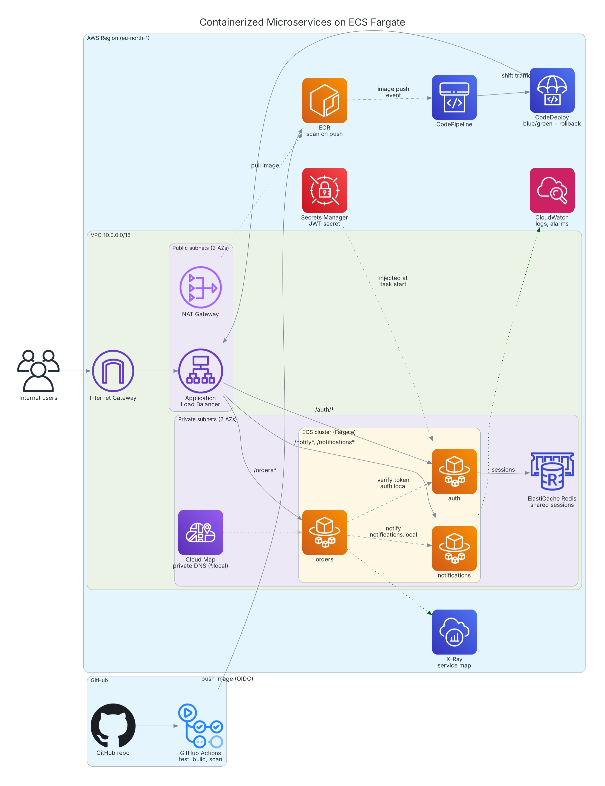
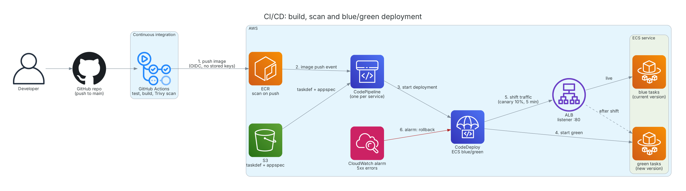

# Containerized Microservices on AWS ECS Fargate

A Node.js application split into three microservices (**Auth**, **Orders**, **Notifications**), running on Amazon ECS Fargate behind an Application Load Balancer. Services discover each other through AWS Cloud Map, secrets come from AWS Secrets Manager, sessions are shared through ElastiCache Redis, and every release is a blue/green deployment with automatic rollback. All infrastructure is defined as code with Terraform, and the build runs on GitHub Actions with no stored AWS keys.

## Table of contents

1. [Solution overview](#solution-overview)
2. [Architecture](#architecture)
3. [AWS services used](#aws-services-used)
4. [Repository structure](#repository-structure)
## Solution overview

A monolithic application is simple to start with but hard to scale and release safely. This project splits it into three independently deployable services:

| Service | Responsibility | Endpoints |
|---|---|---|
| **auth** | Issues and verifies JWTs, keeps sessions in Redis | `POST /auth/login`, `POST /auth/verify`, `GET /health` |
| **orders** | Creates and lists orders, verifies callers through auth, triggers notifications | `POST /orders`, `GET /orders`, `GET /health` |
| **notifications** | Records notifications and logs them to stdout (CloudWatch Logs on ECS) | `POST /notify`, `GET /notifications`, `GET /health` |

Design goals: no servers to manage, zero-downtime releases with automatic rollback, no hard-coded secrets, stateless containers, and everything reproducible from code.

## Architecture



**How a request flows**

1. Users reach the Application Load Balancer through the Internet Gateway. The ALB sits in public subnets across two Availability Zones.
2. Path rules route traffic to the right service: `/auth/*`, `/orders*`, and `/notify*` plus `/notifications*`. Anything else gets a JSON 404.
3. The services run on Fargate in private subnets and have no public IPs. Orders calls Auth and Notifications by Cloud Map DNS name (`auth.local`, `notifications.local`).
4. Auth keeps sessions in ElastiCache Redis (TLS), so any task can serve any request. The JWT signing secret is injected from Secrets Manager when the task starts.
5. Images are built and scanned by GitHub Actions and pushed to ECR. The push triggers CodePipeline, and CodeDeploy shifts ALB traffic from the blue to the green task set, rolling back automatically if a CloudWatch alarm fires or the new tasks fail health checks.
6. Container logs go to CloudWatch Logs, and every request is traced in X-Ray through a sidecar daemon.

### Network layout

The VPC spans two Availability Zones. The ALB and the NAT Gateway live in public subnets, while the Fargate tasks and Redis live in private subnets with no public IPs. The diagram matches `infra/network.tf`.


### Release flow



The diagrams are generated from code (`docs/generate_diagrams.py`). Regenerate them with `pip install diagrams && python3 docs/generate_diagrams.py` (needs Graphviz).

## AWS services used

| Component | AWS service | Purpose |
|---|---|---|
| Network | VPC, subnets, NAT Gateway, security groups | Public/private tiers across two AZs |
| Compute | ECS Fargate | Runs the three services with no servers to manage |
| Registry | ECR | Private images, scan on push, lifecycle policy |
| Ingress | Application Load Balancer | Path-based routing to each service |
| Discovery | Cloud Map | Services reach each other by private DNS name |
| Secrets | Secrets Manager | JWT secret injected at runtime |
| Cache | ElastiCache (Redis) | Shared session store, encrypted at rest and in transit |
| CI | GitHub Actions + OIDC | Test, build, Trivy scan, push to ECR with short-lived credentials |
| CD | CodePipeline + CodeDeploy | Blue/green deployment with automatic rollback |
| Events | EventBridge | Starts a pipeline when an image is pushed |
| Observability | CloudWatch, SNS, X-Ray | Logs, dashboard, alarms, notifications, service map |
| IAM | Roles per component | Separate execution role, task role, pipeline roles, CI role |
| IaC | Terraform | Everything above defined as code |

## Repository structure

```
.
├── README.md
├── LICENSE
├── docker-compose.yml          # local stack (Redis stands in for ElastiCache)
├── .github/workflows/ci.yml    # test, build, scan, push
├── docs/
│   ├── architecture.png        # overall solution
│   ├── network.png             # VPC / subnet / AZ layout
│   ├── cicd.png                # build and blue/green release flow
│   └── generate_diagrams.py    # source of the three diagrams
├── scripts/
│   ├── smoke-test.sh / .ps1    # end-to-end check, local or against the ALB
│   └── push-images.sh / .ps1   # manual first push of the three images
├── services/
│   ├── auth/                   # server.js, tracing.js, Dockerfile, package.json
│   ├── orders/
│   └── notifications/
└── infra/                      # Terraform
    ├── versions.tf  variables.tf  locals.tf  outputs.tf
    ├── network.tf  security_groups.tf       # VPC, NAT, security-group chain
    ├── ecr.tf  ecs.tf  alb.tf               # registry, cluster/services, routing
    ├── cloudmap.tf  secrets.tf  redis.tf    # discovery, JWT secret, cache
    ├── iam.tf  github_oidc.tf               # roles, GitHub OIDC trust
    ├── artifacts.tf  codedeploy.tf  pipeline.tf   # blue/green delivery
    ├── monitoring.tf                        # alarms, dashboard, SNS
    └── terraform.tfvars.example
```


