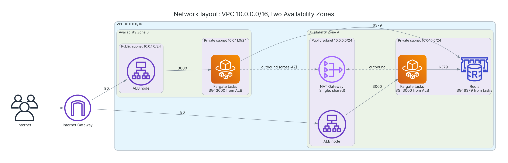

# Containerized Microservices on AWS ECS Fargate

A Node.js application split into three microservices (**Auth**, **Orders**, **Notifications**), running on Amazon ECS Fargate behind an Application Load Balancer. Services discover each other through AWS Cloud Map, secrets come from AWS Secrets Manager, sessions are shared through ElastiCache Redis, and every release is a blue/green deployment with automatic rollback. All infrastructure is defined as code with Terraform, and the build runs on GitHub Actions with no stored AWS keys.

## Table of contents

1. [Solution overview](#solution-overview)
2. [Architecture](#architecture)
3. [AWS services used](#aws-services-used)
4. [Repository structure](#repository-structure)
5. [Run locally](#run-locally)
6. [Deploy to AWS](#deploy-to-aws)
7. [CI/CD pipeline](#cicd-pipeline)
8. [Monitoring and observability](#monitoring-and-observability)
9. [Security](#security)
10. [Cost and cleanup](#cost-and-cleanup)
11. [Design decisions and trade-offs](#design-decisions-and-trade-offs)
12. [Testing](#testing)
13. [Troubleshooting](#troubleshooting)
14. [Deployment evidence](#deployment-evidence)
15. [License](#license)

## Solution overview

A monolithic application is simple to start with but hard to scale and release safely. This project splits it into three independently deployable services:

| Service | Responsibility | Endpoints |
|---|---|---|
| **auth** | Issues and verifies JWTs, keeps sessions in Redis | `POST /auth/login`, `POST /auth/verify`, `GET /health` |
| **orders** | Creates and lists orders, verifies callers through auth, triggers notifications | `POST /orders`, `GET /orders`, `GET /health` |
| **notifications** | Records notifications and logs them to stdout (CloudWatch Logs on ECS) | `POST /notify`, `GET /notifications`, `GET /health` |

Design goals: no servers to manage, zero-downtime releases with automatic rollback, no hard-coded secrets, stateless containers, and everything reproducible from code.

## Architecture


**How a request flows**

1. Users reach the Application Load Balancer through the Internet Gateway. The ALB sits in public subnets across two Availability Zones.
2. Path rules route traffic to the right service: `/auth/*`, `/orders*`, and `/notify*` plus `/notifications*`. Anything else gets a JSON 404.
3. The services run on Fargate in private subnets and have no public IPs. Orders calls Auth and Notifications by Cloud Map DNS name (`auth.local`, `notifications.local`).
4. Auth keeps sessions in ElastiCache Redis (TLS), so any task can serve any request. The JWT signing secret is injected from Secrets Manager when the task starts.
5. Images are built and scanned by GitHub Actions and pushed to ECR. The push triggers CodePipeline, and CodeDeploy shifts ALB traffic from the blue to the green task set, rolling back automatically if a CloudWatch alarm fires or the new tasks fail health checks.
6. Container logs go to CloudWatch Logs, and every request is traced in X-Ray through a sidecar daemon.

### Network layout

The VPC spans two Availability Zones. The ALB and the NAT Gateway live in public subnets, while the Fargate tasks and Redis live in private subnets with no public IPs. The diagram matches `infra/network.tf`.



### Release flow


The diagrams are generated from code (`docs/generate_diagrams.py`). Regenerate them with `pip install diagrams && python3 docs/generate_diagrams.py` (needs Graphviz).

## AWS services used

| Component | AWS service | Purpose |
|---|---|---|
| Network | VPC, subnets, NAT Gateway, security groups | Public/private tiers across two AZs |
| Compute | ECS Fargate | Runs the three services with no servers to manage |
| Registry | ECR | Private images, scan on push, lifecycle policy |
| Ingress | Application Load Balancer | Path-based routing to each service |
| Discovery | Cloud Map | Services reach each other by private DNS name |
| Secrets | Secrets Manager | JWT secret injected at runtime |
| Cache | ElastiCache (Redis) | Shared session store, encrypted at rest and in transit |
| CI | GitHub Actions + OIDC | Test, build, Trivy scan, push to ECR with short-lived credentials |
| CD | CodePipeline + CodeDeploy | Blue/green deployment with automatic rollback |
| Events | EventBridge | Starts a pipeline when an image is pushed |
| Observability | CloudWatch, SNS, X-Ray | Logs, dashboard, alarms, notifications, service map |
| IAM | Roles per component | Separate execution role, task role, pipeline roles, CI role |
| IaC | Terraform | Everything above defined as code |

## Repository structure

```
.
├── README.md
├── LICENSE
├── docker-compose.yml          # local stack (Redis stands in for ElastiCache)
├── .github/workflows/ci.yml    # test, build, scan, push
├── docs/
│   ├── architecture.png        # overall solution
│   ├── network.png             # VPC / subnet / AZ layout
│   ├── cicd.png                # build and blue/green release flow
│   └── generate_diagrams.py    # source of the three diagrams
├── scripts/
│   ├── smoke-test.sh / .ps1    # end-to-end check, local or against the ALB
│   └── push-images.sh / .ps1   # manual first push of the three images
├── services/
│   ├── auth/                   # server.js, tracing.js, Dockerfile, package.json
│   ├── orders/
│   └── notifications/
└── infra/                      # Terraform
    ├── versions.tf  variables.tf  locals.tf  outputs.tf
    ├── network.tf  security_groups.tf       # VPC, NAT, security-group chain
    ├── ecr.tf  ecs.tf  alb.tf               # registry, cluster/services, routing
    ├── cloudmap.tf  secrets.tf  redis.tf    # discovery, JWT secret, cache
    ├── iam.tf  github_oidc.tf               # roles, GitHub OIDC trust
    ├── artifacts.tf  codedeploy.tf  pipeline.tf   # blue/green delivery
    ├── monitoring.tf                        # alarms, dashboard, SNS
    └── terraform.tfvars.example
```

## Run locally

Requires Docker Desktop.

```bash
docker compose up --build
```

Run the automated end-to-end check:

```bash
./scripts/smoke-test.sh          # macOS / Linux / Git Bash
.\scripts\smoke-test.ps1         # Windows PowerShell
```

Or try the flow by hand (PowerShell):

```powershell
$body  = '{"username":"alice","password":"password123"}'
$r     = Invoke-RestMethod -Method Post -Uri http://localhost:3001/auth/login -ContentType 'application/json' -Body $body
$token = $r.token

$order = '{"item":"keyboard","quantity":2}'
Invoke-RestMethod -Method Post -Uri http://localhost:3002/orders -Headers @{Authorization="Bearer $token"} -ContentType 'application/json' -Body $order

Invoke-RestMethod http://localhost:3003/notifications
```

Or with bash:

```bash
TOKEN=$(curl -s -X POST localhost:3001/auth/login -H 'Content-Type: application/json' \
  -d '{"username":"alice","password":"password123"}' | sed 's/.*"token":"\([^"]*\)".*/\1/')

curl -s -X POST localhost:3002/orders -H "Authorization: Bearer $TOKEN" \
  -H 'Content-Type: application/json' -d '{"item":"keyboard","quantity":2}'

curl -s localhost:3003/notifications
```

Expected: an order without a token returns `401`, with a token it returns `201`, and the notification appears. If auth is stopped, orders returns `502` instead of crashing. X-Ray tracing is off locally and only activates when `AWS_XRAY_DAEMON_ADDRESS` is set (as it is on ECS).

## Deploy to AWS

**Prerequisites:** an AWS account, an IAM user with CLI access, the AWS CLI, Terraform 1.6+, Docker, and Git. Run `aws configure` (region `eu-north-1`) and confirm with `aws sts get-caller-identity`.

**1. Create your GitHub repository** and push this project to it. Only the `main` branch of that repository will be allowed to push images.

**2. Configure Terraform.**

```bash
cd infra
cp terraform.tfvars.example terraform.tfvars      # Windows: copy terraform.tfvars.example terraform.tfvars
# edit terraform.tfvars: set github_repo = "your-username/your-repo"
```

**3. Create the infrastructure** (about 10 to 15 minutes; ElastiCache is the slowest part).

```bash
terraform init
terraform validate
terraform plan
terraform apply
```

At the end Terraform prints `app_url`, the ECR repository URLs, and `github_actions_role_arn`.

**4. Push the first images.** ECS services start without images, so their tasks stay "pending" until the images exist.

```bash
./scripts/push-images.sh                  # macOS / Linux / Git Bash
.\scripts\push-images.ps1                 # Windows PowerShell
```

Pushing the `latest` tag starts each service's pipeline, which performs the first blue/green deployment. Watch it in the CodePipeline and CodeDeploy consoles.

**5. Test the deployed stack.**

```bash
./scripts/smoke-test.sh http://<app_url from terraform output>
```

**6. Connect GitHub Actions** so future pushes deploy automatically. In your repository go to Settings, Secrets and variables, Actions, Variables, and add:

| Variable | Value |
|---|---|
| `AWS_ROLE_ARN` | the `github_actions_role_arn` output |
| `AWS_REGION` | `eu-north-1` (only if you changed the region) |
| `PROJECT_NAME` | only if you changed `project_name` |

From now on, a push to `main` runs the tests, builds and scans the images, pushes them to ECR, and triggers the blue/green release.

**7. Clean up** when you are finished (see [Cost and cleanup](#cost-and-cleanup)).

## CI/CD pipeline

**Continuous integration (GitHub Actions, `.github/workflows/ci.yml`)**

- `terraform`: `fmt -check`, `init -backend=false`, `validate` on every push and pull request.
- `test`: starts the full docker compose stack and runs `scripts/smoke-test.sh` (login, rejected and accepted orders, notification delivery).
- `build-scan-push`: builds each image, scans it with Trivy (fails on fixable CRITICAL vulnerabilities), and on `main` pushes it to ECR. AWS access uses GitHub OIDC, so no long-lived keys are stored. The role can only push to the three project repositories and only from `main`.

**Continuous delivery (CodePipeline + CodeDeploy)**

1. Pushing the `latest` tag triggers an EventBridge rule that starts that service's pipeline.
2. The pipeline combines the new image with a `taskdef.json` and `appspec.yaml` bundle that Terraform keeps in S3.
3. CodeDeploy starts the new (green) tasks next to the current (blue) ones, then shifts traffic through the ALB. The default is a canary: 10% for 5 minutes, then the rest. Set `deployment_config_name = "CodeDeployDefault.ECSAllAtOnce"` for faster demos.
4. If the new tasks fail health checks, or the 5xx alarm fires during the shift, CodeDeploy stops and rolls back to blue automatically.
5. The old tasks are terminated one minute after a successful shift.

**Demonstrate a rollback:** push a change that makes `GET /health` return 500. The green tasks never become healthy, the deployment fails, and traffic stays on blue.

**Rolling out an infrastructure change** (for example a new environment variable): `terraform apply` updates the bundle in S3, then re-run the service's pipeline with "Release change" in the CodePipeline console.

## Monitoring and observability

- **CloudWatch dashboard** (`<project>-dashboard`, link in the `dashboard_url` output): alarm status, ALB request count, 5xx errors and latency, CPU and memory per service, Redis CPU.
- **Alarms:** ALB 5xx burst (also wired into CodeDeploy for rollback) and high CPU per service, sent to an SNS topic. Set `alert_email` to receive them.
- **Logs:** every container writes to `/ecs/<project>/<service>` in CloudWatch Logs (7-day retention).
- **X-Ray:** each task runs the X-Ray daemon as a sidecar. Services emit one segment per request, and orders adds remote subsegments for its calls to auth and notifications, so the X-Ray service map shows `orders -> auth` and `orders -> notifications`.

## Security

- Fargate tasks and Redis run in private subnets with no public IPs.
- Security groups form a chain of trust: Internet, then ALB (80), then ECS tasks (3000), then Redis (6379). Each tier accepts traffic only from the tier in front of it.
- Redis is encrypted at rest and in transit (`rediss://`).
- No secrets in code, images or Git. The JWT secret is generated by Terraform, stored in Secrets Manager, and injected at task start. The task definition holds only its ARN.
- Separate IAM roles: the task execution role (pull images, write logs, read the one secret), the task role (X-Ray writes only), CodeDeploy, CodePipeline, EventBridge, and the GitHub Actions role (push to three ECR repositories, `main` branch only).
- ECR scans every image on push, and CI scans before pushing.
- Containers run as a non-root user. The artifact bucket blocks public access and is encrypted.
- `.gitignore` excludes Terraform state, variable files and build output.

## Cost and cleanup

Approximate cost while the stack is running (check the AWS Pricing Calculator for your region): NAT Gateway about $0.05/hour, ALB about $0.025/hour, three small Fargate tasks about $0.04/hour, one `cache.t4g.micro` about $0.02/hour. That is roughly **$0.13 to $0.15 per hour, or about $3 per day** if left running. CodePipeline, CodeDeploy, EventBridge and the other services here add very little.

Deploy, test, record the demo, then remove everything:

```bash
cd infra
terraform destroy
```

Afterwards check the Billing dashboard to confirm nothing is still running, and delete the IAM access key you created for the CLI.

## Design decisions and trade-offs

| Decision | Why | Production alternative |
|---|---|---|
| Single shared NAT Gateway | Cheaper for a demo | One per AZ (`single_nat_gateway = false`) |
| HTTP only on the ALB | No domain required | Route 53 + ACM certificate + HTTPS listener with HTTP redirect |
| In-memory orders, demo users | Keeps the focus on the platform | RDS or DynamoDB for orders, a real user store or Cognito |
| CodeDeploy blue/green | Matches the project brief and gives traffic shifting plus alarm rollback | ECS-native blue/green is now AWS's recommended option |
| One ALB listener with path rules, one target-group pair per service | One public endpoint and one load balancer cost | Separate listener ports or load balancers per service |
| `latest` tag triggers the pipeline | Simple, works with ECR source action | Immutable commit-SHA tags with a pipeline per release |
| Single-node Redis | Cost | Replication group with automatic failover across AZs |
| Trace 100% of requests | Makes the service map fill quickly in a demo | Default X-Ray sampling |
| Local Terraform state | No extra setup | S3 backend with locking (commented example in `infra/versions.tf`) |

## Testing

- `scripts/smoke-test.sh` and `scripts/smoke-test.ps1` run the end-to-end flow against the local stack or the deployed ALB.
- CI runs the smoke test on a fresh docker compose stack for every change, and validates the Terraform.
- Failure behaviour was exercised manually: orders returns `502` when auth is down, auth returns `503` while Redis is down and recovers by itself, and auth exits with a clear error if Redis is unreachable at startup so ECS restarts the task.
- X-Ray instrumentation was checked by capturing the segments the services emit and confirming that orders, auth and notifications join one trace with linked subsegments.

## Troubleshooting

| Symptom | Likely cause and fix |
|---|---|
| Pipelines show a failed Source stage right after `terraform apply` | There is no image in ECR yet. Run the push script; the pipelines rerun on push. |
| ECS tasks stay pending with `CannotPullContainerError` | Images not pushed yet, or built for the wrong CPU architecture. Use the push script (it builds `linux/amd64`). |
| Targets unhealthy in the load balancer | Check the service's CloudWatch log group. The health check calls `GET /health` on port 3000. |
| `OptInRequired` or `SubscriptionRequiredException` during apply | A brand-new account is still activating. Wait and retry. |
| `EntityAlreadyExists` for the GitHub OIDC provider | The account already has one. Set `create_github_oidc_provider = false`. |
| GitHub Actions cannot assume the role | Check `AWS_ROLE_ARN`, that `github_repo` in `terraform.tfvars` matches your repository exactly, and that you pushed to `main`. |
| `terraform destroy` is slow | ElastiCache and the NAT Gateway take several minutes to delete. |

## Deployment evidence

_Add these after deploying (the diagrams and code above describe the design; this section proves it ran):_

- [ ] Screenshot: `terraform apply` output with `app_url`
- [ ] Screenshot: smoke test passing against the ALB URL
- [ ] Screenshot: CodeDeploy blue/green deployment in progress (traffic shifting)
- [ ] Screenshot: CloudWatch dashboard
- [ ] Screenshot: X-Ray service map (`orders -> auth`, `orders -> notifications`)
- [ ] Demo video or live URL: _link here_

## License

MIT. See [LICENSE](LICENSE).
